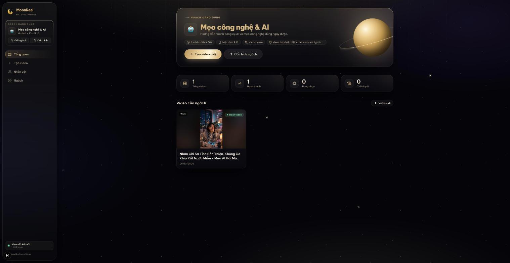

<div align="center">

# 🌙 MoonReel

**Open-source AI video studio by siri2moon.**

Turn a topic into a finished short video with a niche-aware AI script, a recurring character and automatic rendering. Vertical 9:16 for TikTok · Reels · Shorts, and 16:9 for YouTube.



</div>

## Packages

| Package | Description | Status |
|---|---|---|
| [`moonreel-studio`](moonreel-studio) | Web app: niche → AI script → review → per-scene production → MP4 render. Next.js 16, PostgreSQL, pg-boss, FFmpeg, Meta Muse via muse2api. | MVP |

This repository is organised as a monorepo so future pieces can live beside the studio, for example an MCP connector that lets Muse pull jobs directly, or a public landing site.

## Getting started

Setup, configuration, usage and troubleshooting are covered in **[moonreel-studio/README.md](moonreel-studio/README.md)**.

The short version:

```bash
cd moonreel-studio
pnpm install
cp .env.example .env            # set MUSE2API_KEY (openssl rand -hex 32)
docker compose up -d            # Postgres + muse2api
pnpm db:push && pnpm db:seed
# connect a muse.ai account at http://localhost:18610/admin?key=<MUSE2API_KEY>
pnpm dev                        # terminal 1
pnpm worker                     # terminal 2
```

> [!IMPORTANT]
> MoonReel reaches muse.ai through [muse2api](https://github.com/bynne2602/muse2api), an unofficial bridge that uses your account's session cookies. Use a secondary muse.ai account, and never commit cookies or `.env` files.

## Documentation

- [Studio README](moonreel-studio/README.md): installation, configuration, usage, troubleshooting
- [Architecture](moonreel-studio/docs/ARCHITECTURE.md): data model, job pipeline, limits, design language

## License

[MIT](LICENSE) © siri2moon. MoonReel is not affiliated with or endorsed by Meta.
